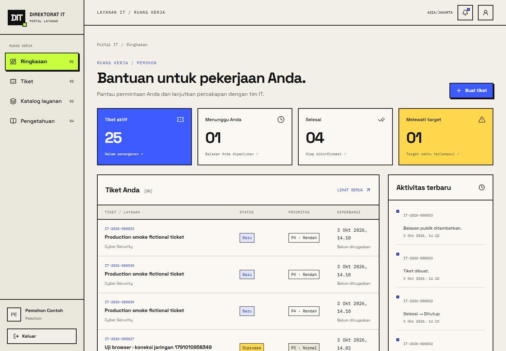
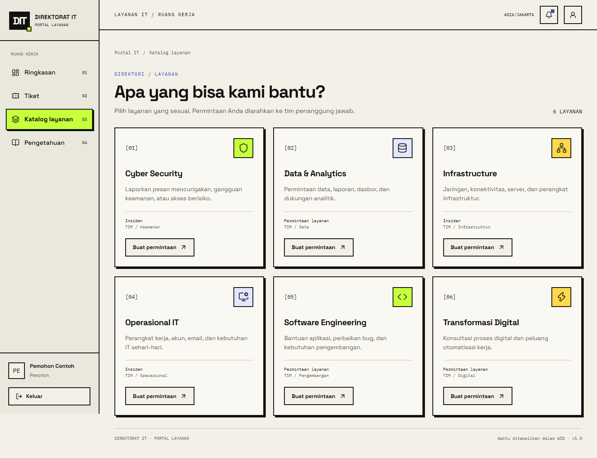
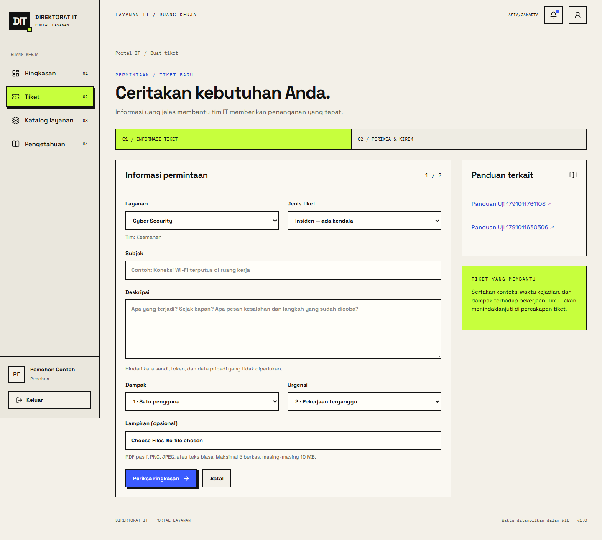
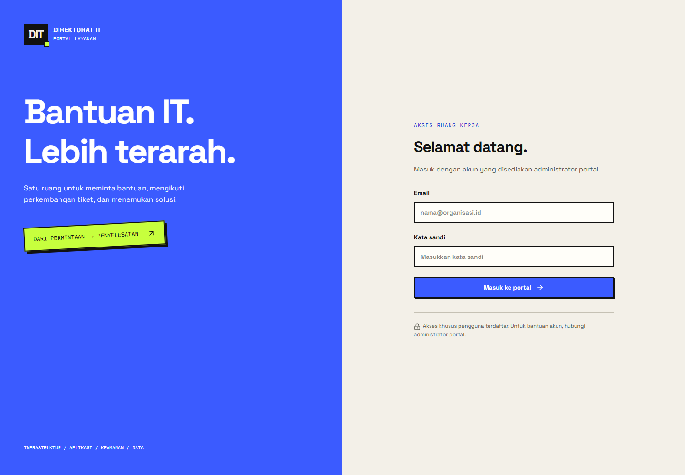
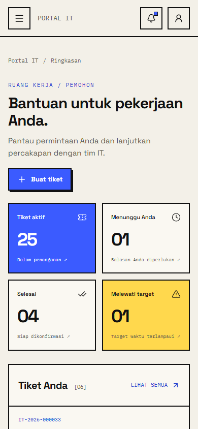

# Portal Layanan IT — Direktorat IT

Portal operasional SvelteKit untuk pemohon, Agen IT, dan Admin. Seluruh tiket, sesi, pesan, riwayat, pengetahuan, dan notifikasi disimpan di PostgreSQL. Tidak ada akun demo otomatis pada runtime, penyimpanan localStorage, atau integrasi email/WhatsApp palsu.

## Screenshot

Tampilan berikut diambil dari aplikasi lokal dengan akun dan data fiktif.

### Dashboard pemohon

Ringkasan tiket aktif, permintaan yang menunggu balasan, dan aktivitas terbaru.



### Katalog layanan

Enam kategori layanan membantu pemohon memilih tim penanggung jawab.



### Membuat tiket

Form permintaan mencakup layanan, dampak, urgensi, dan lampiran sebelum pemeriksaan ringkasan.



### Login



### Tampilan mobile



Screenshot dapat diperbarui dengan `bun scripts/screenshots.ts` saat preview lokal dan akun pemohon contoh tersedia.

## Menjalankan di workspace ini

Bun **1.4.2** dan PostgreSQL **18** digunakan saat verifikasi. Paket dikunci dalam `bun.lock`; adapter Bun menggunakan SvelteKit 2.70.3 yang sesuai dengan peer dependency adapter. `svelte.config.js` memakai format konfigurasi SvelteKit 2.

```powershell
bun install --frozen-lockfile
bun --bun run db:migrate
bun --bun run db:seed
bun --bun run dev
```

Alamat lokal: **http://localhost:5174**. Gunakan hostname `localhost`, sesuai `APP_ORIGIN`; jangan mencampurnya dengan `127.0.0.1` di browser. Database khusus portal berjalan pada `127.0.0.1:55439`, terpisah dari aplikasi lain. `.env` di workspace ini berisi kredensial lokal acak dan tidak boleh dibagikan atau di-commit.

Akun fiktif untuk lingkungan contoh:

| Peran | Email | Kata sandi |
| --- | --- | --- |
| Admin | admin@example.test | `BOOTSTRAP_PASSWORD` di `.env` lokal |
| Agen IT | agen@example.test | `SEED_AGENT_PASSWORD` di `.env` lokal |
| Pemohon | pemohon@example.test | `SEED_REQUESTER_PASSWORD` di `.env` lokal |

Agen contoh menjadi anggota tim Infrastruktur dan Operasional. `pemohon-lain@example.test` digunakan untuk pengujian isolasi dan memakai kata sandi pemohon contoh. Seed tidak mengganti kata sandi akun yang sudah ada. Semua identitas dan kasus seed bersifat fiktif; target waktu adalah konfigurasi contoh, bukan kebijakan perusahaan.

Untuk membuat lingkungan lokal baru, sebelum `.env` atau `.local/postgres` ada:

```powershell
bun --bun run db:local
bun --bun run db:migrate
bun --bun run db:seed
```

`db:local` membuat cluster PostgreSQL tersendiri, database `itportal`, kredensial acak, serta `.env`; tidak membaca atau mengubah database aplikasi lain. Skrip menggunakan instalasi PostgreSQL di `C:/Program Files/PostgreSQL/18/bin` pada Windows; pada Linux binari PostgreSQL harus tersedia pada PATH dan initdb dijalankan sebagai pengguna non-root. Role cluster lokal adalah superuser hanya untuk pengembangan. Gunakan role runtime dengan hak terbatas pada produksi.

Restart/stop cluster lokal yang sudah dibuat:

```powershell
& 'C:/Program Files/PostgreSQL/18/bin/pg_ctl.exe' -D 'D:/VSCODE/itportal/.local/postgres' -l 'D:/VSCODE/itportal/.local/postgres.log' -o '-h 127.0.0.1 -p 55439' start
& 'C:/Program Files/PostgreSQL/18/bin/pg_ctl.exe' -D 'D:/VSCODE/itportal/.local/postgres' stop -m fast
```

## Build dan preview Bun

```powershell
bun --bun run check
bun --bun run test
bun --bun run build
bun --bun run preview:local
```

`preview:local` menjalankan bundle Bun pada origin lokal dan menghindari konflik PORT/ORIGIN yang diwarisi dari shell. Skrip produksi `start` tetap **`bun ./build/index.js`**:

```powershell
$env:HOST='127.0.0.1'
$env:PORT='5174'
$env:ORIGIN='http://localhost:5174'
$env:BODY_SIZE_LIMIT='55M'
$env:NODE_ENV='production'
bun --bun run start
```

Di produksi gunakan HTTPS dan `NODE_ENV=production`; cookie sesi memiliki Secure, HttpOnly, SameSite=Lax. `APP_ORIGIN` harus sama dengan `ORIGIN` dan origin browser. Pembacaan `.env` khusus portal mendahului setting shell untuk konfigurasi aplikasi agar kredensial aplikasi lain tidak terpakai. Jangan tinggalkan `.env` pengembangan pada direktori rilis produksi.

Adapter Bun 1.0.1 secara default force-close koneksi saat shutdown. Wrapper adapter di `svelte.config.js` mengubah dua baris entry yang dihasilkan agar `server.stop(false)` menunggu request selesai sebelum event penutupan pool database. Build gagal jika pola source adapter berubah; tinjau adjustment saat memperbarui adapter. systemd membatasi waktu shutdown sampai 45 detik.

## Fitur dan batas akses

- Pemohon membuat tiket, melihat tiketnya sendiri, membalas secara publik, membatalkan tiket Baru, serta membuka ulang atau menutup tiket Selesai.
- Agen IT menangani tiket timnya, menugaskan agen aktif dari tim yang sama, menambahkan catatan internal, dan mengubah status sesuai lifecycle. Agen membuat tiket hanya untuk layanan timnya, agar tiket baru tetap berada dalam aksesnya.
- Admin menangani semua tiket dan mengelola pengguna, keanggotaan tim, katalog, artikel, target waktu, dan matriks dampak × urgensi. Perubahan pengguna mencabut sesi; Admin aktif terakhir dilindungi dengan lock transaksi.
- Status tertutup/dibatalkan terminal. Tiket tertutup dapat dijadikan referensi tiket baru. Resolusi wajib memiliki catatan. Riwayat append-only dilindungi trigger database.
- Pencarian dan filter tiket berada di URL, dengan paginasi query database (12 tiket/halaman). Dashboard menghitung data dalam akses pengguna.
- Catatan internal difilter sebelum serialisasi server, tidak disertakan dalam notifikasi, dan tidak tersedia untuk pemohon. Notifikasi dan unduhan memeriksa akses saat dibaca.
- Target respons pertama tidak berhenti. Target penyelesaian berhenti saat Menunggu pemohon dan dilanjutkan dengan sisa durasi setelah balasan pemohon. Durasi negatif dipertahankan untuk tiket yang sudah terlambat. Semua timestamp disimpan sebagai timestamptz dan ditampilkan dalam Asia/Jakarta.
- Artikel teks biasa menghindari rendering HTML yang tidak dipercaya. Pengetahuan hanya untuk pengguna terautentikasi.

## Database, migrasi, dan lampiran

Migrasi SQL berurutan dalam `migrations/` dijalankan transaksional dan dicatat pada `portal_migrations`. `src/lib/server/schema.ts` mendefinisikan tabel Drizzle; queries menggunakan Drizzle SQL berparameter melalui postgres-js. `drizzle.config.ts` tersedia untuk inspeksi/generasi perubahan; migrasi SQL versioned adalah sumber deployment, jangan menjalankan `drizzle-kit push` pada database produksi.

Tabel: users, teams, memberships, sessions, services, target_settings, priority_settings, tickets, messages, attachments, ticket_events, articles, notifications, login_attempts. Foreign keys mempertahankan relasi sejarah; entitas dinonaktifkan alih-alih dihapus. Indeks mencakup antrean pemohon/tim, layanan/prioritas, penugasan, timeline, inbox, sesi, dan trigram untuk pencarian subjek/nomor. Instalasi extension `pg_trgm` memerlukan hak migrasi yang sesuai. Nomor tiket berasal dari sequence database; nomor dapat memiliki gap setelah rollback dan melebar setelah enam digit.

`UPLOAD_DIR` adalah penyimpanan privat di luar static/public/build-client. Tiap tiket menerima maksimal 5 lampiran, masing-masing 10 MB. Server membatasi ukuran, mencocokkan ekstensi/MIME/isi, menolak traversal, mendecode dan menulis ulang PNG/JPEG (maksimal 25 megapiksel), serta memeriksa PDF pasif. PDF terenkripsi, formulir aktif, object streams, nama terenkode, skrip, tindakan eksternal, dan embedded files ditolak. Beberapa PDF valid yang kompleks harus diekspor ulang sebagai PDF sederhana. Teks berisi markup aktif juga ditolak.

Berkas distage, metadata dan event dibuat dalam transaksi, kemudian berkas dipindahkan ke nama UUID sebelum commit. Kegagalan normal menghapus berkas staged/final. Crash atau hasil commit yang tidak diketahui tetap memerlukan rekonsiliasi filesystem/database: jalankan `bun scripts/reconcile-uploads.ts` untuk laporan read-only. Jangan otomatis menghapus orphan segera; pastikan tidak ada transaksi berjalan dan lakukan backup dahulu. Database dan filesystem tidak memiliki transaksi bersama. Tidak ada antivirus eksternal; gambar ditulis ulang dan PDF dibatasi, bukan pemindaian malware universal.

Sesi: token acak 256-bit, hanya SHA-256 token disimpan. Login merotasi sesi lama; logout, perubahan kata sandi, dan perubahan pengguna mencabut sesi. Hash kata sandi Argon2id memakai Bun.password. Rate limit persisten: 10 percobaan/email dan 50/IP per 15 menit. `APP_ORIGIN` diperiksa untuk setiap mutasi selain pemeriksaan CSRF bawaan SvelteKit. Identitas/peran berasal dari sesi server.

## Verifikasi

```powershell
bun --bun run test
bun --bun x playwright install chromium
# Jalankan preview pada terminal lain:
bun --bun run test:browser
bun --bun run test:admin-browser
bun --bun run measure
# Hentikan preview dahulu: smoke menjalankan bundle pada port yang sama
bun --bun run test:production
```

`test` membuat/menggunakan database lokal **itportal_test**, menerapkan migrasi, dan melakukan seed fiktif. Pengguna database lokal memerlukan CREATEDB; runner menolak provisioning otomatis pada host nonlokal. Upload test terpisah pada `.local/test-uploads`. Browser/smoke memakai preview dan menambah tiket fiktif; jangan menjalankannya terhadap data produksi. Hasil dan screenshot berada di `artifacts/`; ringkasan verifikasi yang benar-benar dijalankan ada di `VERIFICATION.md`.

Target Lighthouse bukan jaminan. Ukur ulang pada server dan perangkat deployment, jaringan nyata, dan data yang representatif. Audit otomatis tidak menggantikan uji pembaca layar/manual menyeluruh.

## Operasional produksi

Portal aktif di **https://itportal.kskgroup.web.id** sejak 3 Oktober 2026. Catatan deployment khusus server disimpan secara privat di workspace dan dikecualikan dari repositori. Panduan operasional umum tersedia dalam direktori `ops/`.

`ops/itportal.service` adalah template systemd. Siapkan akun sistem itportal, Bun 1.4.2, PostgreSQL khusus itportal, role migrasi, role runtime, direktori upload privat, dan file environment dengan mode 0600. Contoh target response/resolution dan katalog perlu ditinjau Admin sebelum penggunaan nyata. Set `SEED_DEMO=false`; bootstrap hanya memerlukan email dan kata sandi Admin dari environment. Google sign-in memerlukan `GOOGLE_CLIENT_ID`, `GOOGLE_CLIENT_SECRET`, serta `GOOGLE_ALLOWED_DOMAINS` berisi domain email yang diizinkan. Domain kosong menolak identitas Google baru dan penautan akun; akun baru pada domain yang diizinkan dibuat sebagai Pemohon dan Admin dapat mengubah peran/timnya. Identitas Google disimpan dengan subject stabil dari Google. Reset kata sandi email tidak tersedia.

Bind Bun ke loopback di belakang reverse proxy yang dipercaya. Gunakan ORIGIN statis yang sama dengan APP_ORIGIN agar Host/X-Forwarded-* tidak menentukan origin keamanan. Jangan konfigurasi ADDRESS_HEADER untuk trafik langsung. Jika memerlukannya, proxy harus menghapus header spoofed lalu memasang header alamat yang terpercaya; lihat `ops/reverse-proxy.md`. Pastikan batas body proxy 55 MB dan idle timeout cukup untuk upload. `/healthz` memberikan status ready/unavailable tanpa detail kredensial.

Backup, restore, serta rollback dijelaskan di `ops/backup-rollback.md`. Backup harus mencakup database dan upload pada satu jendela konsisten. Rilis rollback menggunakan artifact sebelumnya jika skema kompatibel; perubahan destruktif memerlukan restore ke database khusus baru dari backup. Tidak ada migrasi turun otomatis yang menghapus sejarah.

Email/WhatsApp, monitor infrastruktur, kalender kerja, eskalasi kompleks, dan laporan SLA kontraktual berada di luar v1. Portal telah dideploy pada domain publik; companion site `D:/VSCODE/it_direktorat` tidak berubah.
